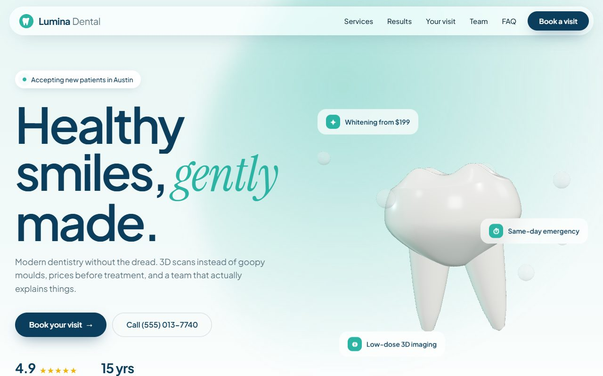

# Lumina Dental

**Dental clinic website** · a concept project by [Mayank Mehra](https://mayankmehra.pages.dev)

[](https://lumina-dental-a4x.pages.dev)

**Live site:** https://lumina-dental-a4x.pages.dev

## The brief

A modern clinic that wanted to feel calm and trustworthy, and to take bookings online without phone tag.

## Signature moment

A 3D tooth modelled entirely in code, plus a before/after whitening slider.

## What I built

- Procedural 3D tooth with glass bubbles
- Draggable before/after whitening comparison
- Three-step booking widget with live time slots
- No framework, no build step: fast and dependable

## Tech

HTML · CSS · JavaScript · Three.js

## Run it locally

No build step. Open `index.html`, or serve the folder:

```bash
npx serve .
```

---

More of my work: **[mayankmehra.pages.dev](https://mayankmehra.pages.dev)**
